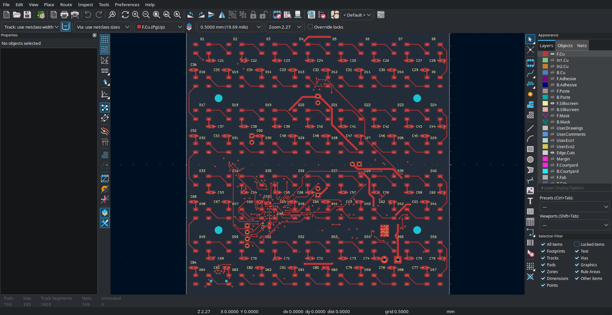
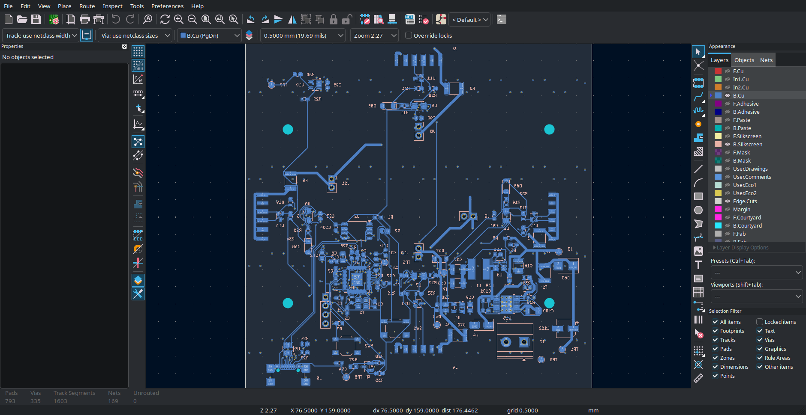
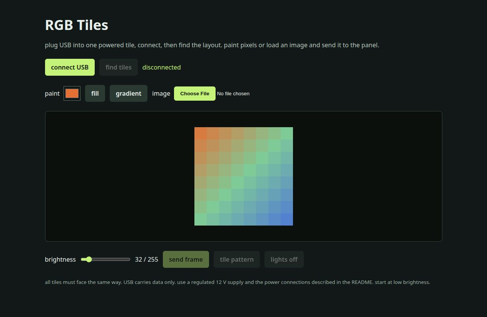

# RGB Tiles

a modular RGB LED display made from identical PCBs. each tile has 64 LEDs and its own RP2040. connect them into a strip, a square, or a shape with gaps in it. all the tiles face the same way

i started with nine tiles in mind, but the layout isn't fixed to a 3 x 3 panel. the firmware reads the connections on each edge and works out where the tiles are. this version has room for 128 tiles in one connected layout. larger displays need more power connections and take longer to update

## the tile

- 8 x 8 WS2812C-V6 LEDs, with 12.5 mm pixel spacing
- 99.5 x 99.5 mm PCB on a 100 mm tile pitch
- four copper layers
- RP2040, 2 MB flash, USB-C, BOOT, RESET and SWD
- buffered serial links on all four edges
- 12 V distribution with a local 5 V buck converter and 3.3 V regulator
- protected power inlet, a resettable fuse for the tile, and separate fuses and removable power links for the edges

male connectors are on the north and west edges. female connectors are on the south and east edges. the 0.5 mm gap between boards keeps the pixel spacing the same across the joins. the boards also need a backing frame to keep the connectors aligned and support the panel

## files

open [rgb-tiles.kicad_pro](rgb-tiles.kicad_pro) in KiCad 10. the root schematic opens the controller, LEDs, power, protected inlet, edge links and USB sheets

| path | contents |
| --- | --- |
| `schematic/` | schematic pages |
| `RGB_Tiles.pretty/` | custom footprints |
| `manufacturing/` | Gerbers, drills and parts list |
| `firmware/` | RP2040 firmware and build instructions |
| `controller/` | browser pixel editor |
| `images/` | board pictures and the original layout sketch |

## power

USB is for data. it does not power the LEDs or the controller. use a regulated 12 V DC supply with the polarity marked at J7

for the first full-brightness setup, run a separate power branch to J7 on every tile. allow 1 A per tile, so nine tiles need a 12 V supply rated for at least 9 A. use one supply for the whole panel. the inlet protection is set to about 2 A per feed, so one inlet cannot power a whole nine-tile panel

the edge power links are J8 north, J9 east, J10 south and J11 west. a fitted shunt connects that edge to the tile's 12 V bus. leave both shunts out at a boundary between separately powered sections. the data and ground connections still join across that boundary

start with low brightness. sharing power through the edges needs a load and voltage-drop check for the actual arrangement. the edge design target is 0.8 A continuous, including both parallel power contacts. the resettable fuses are not precise current limiters

## firmware and control

build and flash the same firmware onto every tile. [firmware/README.md](firmware/README.md) has the commands and pin map

open [controller/index.html](controller/index.html) in a browser with Web Serial support, such as Chrome or Edge. connect USB to one powered tile, click `connect USB`, then `find tiles`. allow a few seconds for discovery after connecting or rearranging tiles

paint pixels, fill the panel, or load an image. `send frame` uploads each tile's pixels and waits for acknowledgements before switching the display. `tile pattern` helps check the positions and orientation. brightness starts at 32 out of 255

## board fabrication

[manufacturing/gerbers.zip](manufacturing/gerbers.zip) contains the four copper layers, solder masks, silkscreens, outline, plated drills and unplated drills. [manufacturing/bom.csv](manufacturing/bom.csv) lists the exact parts for one tile, including the four removable shunts

order as a 99.5 x 99.5 mm, four-layer, 1.6 mm FR-4 board with 1 oz outer copper and 0.5 oz inner copper. the project uses the JLC04161H-7628 stackup. the smallest track is 0.2 mm, minimum clearance is 0.15 mm, and all via drills are 0.3 mm. use lead-free HASL and green solder mask. both sides have components

this is a design submission. the PCB has not been assembled. the firmware builds, and the discovery, routing and command handling have been checked in software

made for Hack Club Half Life, week 4

[Half Life project](https://halflife.hackclub.com/projects/c01og00redvbnb7qoo1i9yo8)
